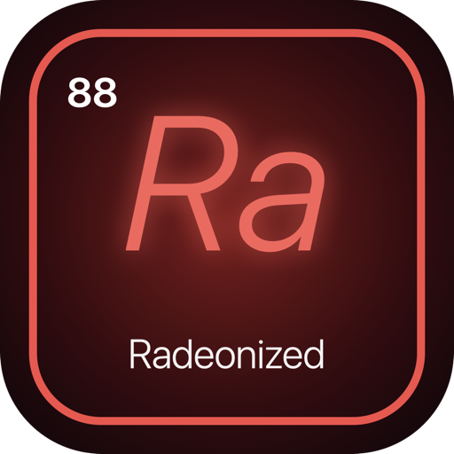

<p align="center">
  
</p>

<p align="center">
  <b>Graphics for the AMD Radeon Rembrandt on macOS.</b><br>
  A kernel extension, a Lilu plugin and a framebuffer for Rembrandt APUs, booted through OpenCore.
</p>

<p align="center">
  
  
  
  
</p>

<p align="center"><b>English</b></p>

---

## What works

Measured on a Ryzen 7 7735HS laptop running macOS Tahoe 26.7, with the
firmware set to iGPU-only (Eco) mode. Everything is recorded in
`docs/JOURNAL.md`.

- **Full Metal acceleration.** The GPU appears in System Profiler as
  `AMD Radeon 680M`, Metal 3, 4 GB. Metal output is bit-exact against the
  reference, and Geekbench Metal lands around 22k once VRAM is raised past the
  512 MB default.
- **The built-in panel.** `RBAMDFramebuffer` owns the laptop's screen, with
  brightness control and a refresh ladder derived from the panel's own
  timings — roughly 91–140 fps on the desktop depending on refresh state.
- **Apple's compositor runs on the GPU**, the same way it would on a supported
  Mac, rather than through a software path.
- **OpenGL apps render correctly.** OpenGL draws through a *second* driver
  image with its own tiling logic that the Metal path never touches — the
  reason Java/JavaFX apps and Steam's built-in browser used to show eaten
  glyphs and scrambled images. The fix for that image is on by default.
- **USB runs on real interrupts** rather than polling.
- **It gets out of the way when it should.** Recovery and the macOS installer
  come up completely stock, so they stay usable as a way back, and a boot that
  fails to survive 60 seconds makes the next one stock automatically.

## Work in progress

- **External displays over USB-C DisplayPort: not working yet.** DP alt mode
  is granted, the sink answers over AUX, the pixel clock runs — and the PHY
  feeding the port is held in reset, which nothing on the driver side
  releases. AMD's own Linux driver has no PHY bringup for this generation; the
  display firmware owns it, and the one firmware command that targets that
  state returns no reply. Recorded in full in `docs/JOURNAL.md`. On
  laptops where HDMI is wired to the discrete GPU, HDMI and panel brightness
  are also mutually exclusive.
- **WebGL with antialiasing.** `getContext('webgl')` defaults to
  `antialias: true`, and multisampled *colour* surfaces fail to allocate, so
  some browser pages render white. Multisampled depth and stencil are fine,
  and everything single-sampled is fine.
- **Small monochrome UI glyphs can speckle** in some apps — Steam's status
  badges are the known case, while its text and artwork are correct. Traced as
  far as "not the OpenGL path"; the current candidate is a Metal surface class.
- **Occasional stalls.** Work is sometimes submitted that never retires,
  showing up as a few seconds of lag. Not reproducible on demand yet.
- **macOS versions.** Only Sequoia and Tahoe are claimed in
  `src/common/rb_osver.h`. Ventura and up will load, and are unmeasured.
- **Device IDs.** Everything has been measured on `1002:1681`. `1002:164d` is
  the same silicon and is matched, but no machine carrying it has booted this.

## What it needs

- A Ryzen 6000 / 7x35 laptop with a Rembrandt iGPU, booting macOS via OpenCore
- macOS Sequoia (15) or Tahoe (26)
- Lilu in the EFI
- **The firmware set to iGPU-only (Eco) mode.** On a switchable-graphics
  laptop the panel and its backlight can be wired to the discrete GPU, and
  then none of this reaches the screen. It is a firmware setting, not
  something software can work around.
- SIP relaxed enough to load unsigned kexts

## Installing with the app

`app/` is **Radeonize**, a macOS app that does the whole install. See
`app/README.md`.

It checks the Mac is a Rembrandt machine on a supported macOS, downloads the
latest release and verifies its checksum before unpacking, lists the EFI
partitions and marks the one holding OpenCore, reads this machine's own VBIOS
out of its ACPI tables and puts it in the plugin, then installs both kexts by
their two different mechanisms — the plugin into `EFI/OC/Kexts/` with
`config.plist` edited to load it after Lilu, and the framebuffer into
`/Library/Extensions/` with the auxiliary kernel collection rebuilt.

Every change is backed up first, into
`~/Library/Application Support/Radeonize/backups/`, and can be restored from
there. Each write is verified before the app reports success, and rolls back
if verification fails. Root is used only by one small helper script, through
the standard administrator prompt.

Reboot when it finishes.

## Building

You need Xcode (or its Command Line Tools) and three sources that are not in
this repository:

- **MacKernelSDK** headers and libraries, placed at `third_party/MacKernelSDK`.
- **Lilu**, placed at `third_party/Lilu`. Lilu is BSD-3-Clause.
- One Linux header, which `sh tools/fetch_linux_ref.sh` fetches into
  `third_party/linux-ref` pinned to v6.6 and checked against its digest. The
  host tests include it unmodified so they check the power-management code
  against the kernel's own struct definitions rather than a transcription of
  them.

```sh
sh tools/fetch_linux_ref.sh   # the one kernel header the tests include
make kext tools               # build the probe kext and the host tests
make fbkext                   # build the framebuffer kext
make plugin                   # build the Lilu plugin (needs Lilu)
make plugin RELEASE=1         # the same plugin, carrying nobody else's bytes
```

`make kext` runs the host tests first. Never load a kext whose host tests fail.

`RELEASE=1` is what a published binary is built with, and it builds into
`build-release/` so it can never pick up an object file from a development
build. The one thing it leaves out is the board's VBIOS, which is not this
project's to hand on; it picks up the machine's own instead, as the next
section describes. Everything else is identical.

`NOFW=1` additionally leaves out the AMD firmware images that the
experimental PSP path can substitute. Nothing in the shipping configuration
reads them — the path that would is a dry run without `-rbgpupsphw` — but
**do not ship a build made with it yet**:

> **Open defect: the accelerator races HWLibs, and the margin is ~3 ms.**
> HWServices starts two children asynchronously — HWLibs, by IOKit matching,
> and the accelerator, internally — and the accelerator's `createHWInterface`
> needs a patch this plugin applies to HWLibs once it is loaded. Three
> archived good boots win that race by 2.5, 2.6 and 3.6 ms. Dropping the
> firmware images shrinks the plugin from 1818032 bytes to 455088 and moves
> the margin to **−67.8 ms**: three consecutive boots came up unaccelerated,
> with the patch landing 68 ms after the accelerator had given up. The
> firmware bytes are therefore ballast that happens to win a race, and the
> race is the real defect. It should be ordered explicitly rather than won on
> timing, because a faster or slower disk decides it.

## The VBIOS

Apple's graphics stack wants the card's video BIOS as an `ATY,bin_image`
property, and on an APU there is no ROM to read it from — the image lives in
an ACPI table called VFCT, which is why a released build ships without one
and picks up the machine's own instead.

The app does this step by itself. By hand, it is:

```sh
sudo tools/efi.sh sysreport-on     # ask OpenCore to dump the ACPI tables, then reboot
sudo tools/efi.sh vbios            # pull the image out of the VFCT table
python3 tools/vbios_plist.py build-release/out/RembrandtGPU.kext firmware/680m-vbios.rom
python3 tools/vbios_plist.py build-release/out/RembrandtGPU.kext --check
```

That writes the image into the kext's own `Info.plist`, where IOKit hands it
to the driver on the next boot. A development build already has one compiled
in, and the bundle's copy wins over it, so either can be swapped for the
other without rebuilding. The peer logs which of the two it used, and says so
plainly when it has neither.

## Installing manually

Installing changes the EFI and the system kernel collection. Read
`docs/RULES.md` first.

```sh
sudo tools/efi.sh install     # add the plugin to the OpenCore EFI
sudo tools/fbinstall.sh       # rebuild the auxiliary kernel collection with the framebuffer
```

Reboot after each step. Both print the UUID they installed — check it against
what was just built, because an install that silently did nothing looks
exactly like one that worked. `sudo tools/efi.sh status` shows what is in the
EFI right now, and `tools/efi.sh restore` and the app's Restore button put
back the configuration saved before a change.

## If a boot goes wrong

In rough order of bluntness, as boot-args or NVRAM keys:

| | what it does |
| --- | --- |
| *(nothing)* | a boot that dies inside 60 s makes the next one stock by itself |
| `sudo nvram rbgpu-arm=0` | acceleration off next boot |
| `-rbgpustock` | every feature off, plugin otherwise alive |
| `-rbgpuoff` | the plugin loads and does nothing — the documented rescue |

Recovery always boots stock, so it stays available as a way back.

## Layout

- `src/kext/` — `RembrandtProbe`, a read-only probe of the GPU.
- `src/fbkext/` — `RBAMDFramebuffer`, the framebuffer kext for the built-in panel.
- `src/plugin/` — `RembrandtGPU`, the Lilu plugin that boots from the OpenCore EFI.
- `src/common/` — shared C code used by the kexts, the plugin and the host tests.
- `tools/` — build helpers, install scripts (`efi.sh`, `fbinstall.sh`) and probes.
- `tests/data/` — the IP discovery table read off the GPU, which two of the
  host tests check the code's register segments against.
- `app/` — Radeonize, a macOS app that checks the Mac and installs the kexts.
- `docs/PLAN.md`, `docs/JOURNAL.md`, `docs/RULES.md` — the plan, the measured
  record, and the engineering rules the code follows.

Every register offset in the code cites the Linux header it was taken from.

## License

Code in this repository is MIT licensed. See `LICENSE`. That covers the code
and nothing else, and the build is arranged so that it does not have to cover
anything else:

- **Lilu** and **MacKernelSDK** are fetched separately and keep their own
  licenses. Lilu is BSD-3-Clause.
- The one **Linux** header the tests include is GPL-2.0-only, is fetched by
  `tools/fetch_linux_ref.sh` rather than copied in here, and is used by the
  host tests only. Register offsets quoted in comments cite the kernel header
  they came from.
- The **VBIOS** belongs to the board vendor. A released build carries none;
  it uses the image already present in the machine it is installed on.
- The **AMD firmware images** from linux-firmware are transcribed into
  `src/plugin/fw_yellow_carp*.cpp` and are compiled into the plugin. They keep
  AMD's own license, reproduced verbatim in
  [`third_party/LICENSE.amdgpu`](third_party/LICENSE.amdgpu) as that license
  requires, with the summary and the notices in
  [`third_party/README.md`](third_party/README.md). It permits installing,
  reproducing, copying and distributing the microcode **in binary form only**,
  free of license fees, on three conditions: no reverse engineering,
  decompilation or disassembly of the microcode, and reproduction of the
  copyright notice, permission notice and disclaimers in the accompanying
  materials — which is what those two files are. It sets **no condition about
  distributing the files unmodified**; an earlier version of this section said
  otherwise and was wrong. Nothing here disassembles the microcode: the images
  are moved as opaque bytes.
  `NOFW=1` builds without them, but **that build is not expected to
  accelerate**: boot 542 measured `yc_swapped 12`, so the images are consumed
  twelve times on an accelerated boot and are functionally required.
